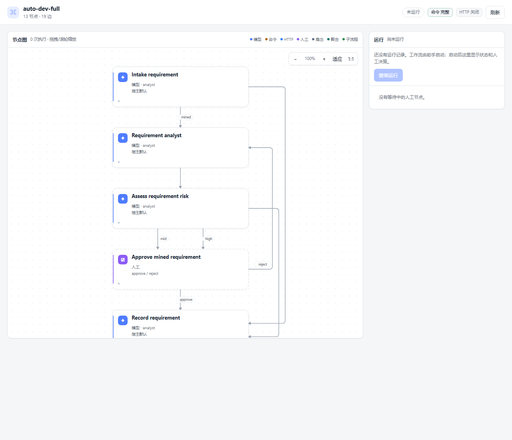

# dsh-agent-team-workflow

> A node-graph workflow runtime for DeepSeek Harness: agent, command, HTTP, human, fan-out/join and sub-workflow nodes, with artifacts, permissions and a live web board.

`dsh-agent-team-workflow` is a DSH plugin. A workflow is a graph of typed nodes;
edges choose the next node from an outcome. The runtime owns scheduling and
permissions; nodes do the work.

**Status:** v2 node runtime. The v2 node runtime replaces the old stage/kanban engine
entirely. There is no v1 compatibility layer, state migration or dual tool set.

## Concepts

| Term | Meaning |
| --- | --- |
| Definition | `apiVersion: 2` JSON: providers, nodes, edges, entry. |
| Node | One typed unit: `agent`, `command`, `http`, `human`, `fanout`, `join`, `gate`, `subworkflow`. |
| Edge | `{from, to, on}`; `on` is an outcome, default `complete`. |
| Token | One execution of a node. A run has many tokens. |
| Run | One workflow execution with input, context and tokens. |
| Artifact / context | Node outputs stored under `context.nodes.<id>`; mapped into later nodes. |
| Permission grant | User-approved command/HTTP capability, stored with the workflow. |
| Lane | A provider route: `adapter`, `model`, `reasoningEffort`, `maxTokens`. |

State is per DSH session under `<dataDir>/sessions/<sessionId>`:

- `workflow.json` — definition + permission grant;
- `runs/<runId>.json` — token state, context, status.

Writes are atomic JSON, with checkpoints before and after every node. Runs bind a repository cwd at start. Host shutdown preserves evidence but does not automatically replay uncertain in-flight work. See [run lifecycle and troubleshooting](docs/run-lifecycle.md).

## Install

```bash
# from GitHub
dsh plugin --profile desktop add github:lyingloong/dsh-agent-team-workflow

# or from a local checkout
dsh plugin --profile desktop add /absolute/path/to/dsh-agent-team-workflow

# restart the Harness process, then refresh the Web GUI
```

Package: `dsh-agent-team-workflow`. Requires Node.js >= 22.5.

## Use from a session

Describe the workflow in natural language. The model composes a definition and
calls the tools:

> 创建一个自动开发的工作流：一个实现者、一个测试命令、一个审查者；审查不通过回到实现，通过后我批准才合并。

The model will ask before granting command/HTTP access. Typical sequence:

1. `team_workflow_define` — validate and store the definition and the permission grant.
2. `team_workflow_start` — bind the absolute target `cwd`, preflight, and create a run with input.
3. `team_workflow_run` — dispatch a session-owned job and return immediately; collect it with `job_output`, stop it with `job_kill`.
4. `team_workflow_decide` — resolve a waiting human node.
5. `team_workflow_status` — inspect the definition and latest run.

### Tools

| Tool | Purpose |
| --- | --- |
| `team_workflow_define` | Validate and store a definition plus permission grant. |
| `team_workflow_start` | Bind a repository cwd and preflight a new run; history is preserved. |
| `team_workflow_run` | Start/find a managed job; return cwd, jobId and current-node progress without blocking. |
| `team_workflow_decide` | Resolve a waiting human token. |
| `team_workflow_status` | Read persisted cwd/job/current-token/checkpoint/error state without executing anything. |

## Permissions

Permissions are never part of the definition. The session must ask the user
before creating a workflow that uses `command` or `http` nodes.

```json
{
  "command": { "mode": "allowlist", "allow": ["pnpm", "node"] },
  "http": { "mode": "allowlist", "allow": ["api.github.com"] }
}
```

Modes: `deny` (default), `allowlist`, `full`. The runtime checks each command
string or HTTP host before the executor runs. A denied node fails with
`permission_denied`; it is not retried. If the user does not grant access, design
a restricted workflow (agent/human/fanout/join only) or use an allowlist.

## Definition

```json
{
  "apiVersion": 2,
  "name": "dev-team",
  "entry": "seed",
  "providers": [
    { "id": "default", "adapter": "deepseek", "model": "host-default" }
  ],
  "nodes": [
    { "id": "seed", "type": "human", "config": { "outcomes": ["approve", "reject"] } },
    {
      "id": "implement",
      "type": "agent",
      "role": "engineer",
      "inputs": { "request": "$input.request" },
      "config": { "lane": "default", "prompt": "Implement the request." }
    },
    {
      "id": "test",
      "type": "command",
      "config": { "command": "pnpm test", "timeoutMs": 300000 }
    },
    {
      "id": "review",
      "type": "agent",
      "role": "reviewer",
      "inputs": { "implementation": "$nodes.implement.output", "tests": "$nodes.test.output" },
      "config": { "outcomes": ["pass", "needs_revision"], "prompt": "Review the change." }
    },
    { "id": "merge", "type": "human", "config": { "outcomes": ["approve", "reject"] } }
  ],
  "edges": [
    { "from": "seed", "to": "implement", "on": "approve" },
    { "from": "implement", "to": "test", "on": "complete" },
    { "from": "test", "to": "review", "on": "complete" },
    { "from": "review", "to": "merge", "on": "pass" },
    { "from": "review", "to": "implement", "on": "needs_revision" }
  ]
}
```

### Node types

| Type | Config | Behavior |
| --- | --- | --- |
| `agent` | `role?`, `prompt?`, `lane?`, `provider?`, `model?`, `models?`, `cwd?`, `outcomes?`, `outcome?` | Spawns a DSH subagent. The child returns JSON `{outcome, output}`; plain text becomes `{text}`. |
| `command` | `command`, `cwd?`, `timeoutMs?` | Runs a shell command in the session cwd. Exit 0 → `complete`; non-zero → `fail`. |
| `http` | `url`, `method?`, `headers?`, `body?`, `timeoutMs?` | `fetch`; 2xx → `complete`, otherwise `fail`. |
| `human` | `title?`, `outcomes?` | Waits for `team_workflow_decide` or the web board. Default outcomes: `approve`, `reject`. |
| `fanout` | `items`, `target`, `join` | Resolves `items` to an array and creates one branch token at `target`; each branch receives `$item` and `$index`. |
| `join` | `mode: all\|any\|quorum`, `count?` | Aggregates branch outputs; `all` waits for every branch. |
| `gate` | none | Continuous-run switch. Passes when the session control is enabled; otherwise waits for the queue to accumulate. |
| `subworkflow` | `definition` | Runs an inline nested definition and exposes its context as the node output. |

Agent nodes use the lane's `adapter/model/reasoningEffort/maxTokens` as subagent
`agentOptions`. `model: "host-default"` inherits the host model. An explicit
`provider`/`model` on the node overrides the lane and selects the executor;
`cwd` is forwarded to the subagent as its starting directory; relative paths
resolve against the session working directory.

An agent node can instead carry an ordered `models` fallback list:

```json
"models": [
  { "provider": "provider-a", "model": "model-1" },
  { "provider": "provider-b", "model": "model-2" }
]
```

The executor tries them in order on a subagent/provider error; a task `fail`
outcome is not a provider error and is returned as the node outcome. The board
shows the ordered list; definitions are edited by the session model through the
tools.

A command exits 0 for `complete` and non-zero for `fail`. A `fail` outcome must
have an outgoing `on: "fail"` edge; otherwise the run itself fails with
`unhandled_failure` instead of silently reporting `done`.

### Inputs and outputs

Values in `inputs` are resolved from:

- `$input` — the run input object;
- `$nodes.<id>.output` — a previous node's output;
- `$item`, `$index` — fan-out branch values;
- `$context` — the whole run context.

A completed node's output is stored at `context.nodes.<id>` and is available to
later nodes. The join node's output is an array of branch records:
`[{branch, outcome, output}, ...]`.

### Edges

An edge is taken when the node outcome equals `on`. No matching edge makes the
token terminal. Several edges with the same outcome create parallel branches.
Agent nodes can return one of their configured `outcomes`, which makes review
pass/fail loops ordinary graph edges.

## Fan-out / join

```json
{
  "id": "split",
  "type": "fanout",
  "config": { "items": "$input.items", "target": "work", "join": "join" }
}
```

Start with `{"items": [1, 2, 3]}`. The fanout node creates three tokens at
`work`; each sees `$item` and `$index`. `join` waits according to its mode, then
its output is the aggregated branch array.

A join waits internally for its branches; that wait is not a human decision. The
`waiting` list from `team_workflow_run`, `team_workflow_status`, the web board and the
Web API contains only `human` node tokens, and `team_workflow_decide` rejects a
join token with `not_decidable`.

## Sub-workflow

```json
{
  "id": "child",
  "type": "subworkflow",
  "inputs": { "value": "$input.value" },
  "config": { "definition": { "apiVersion": 2, "name": "child", "entry": "work", "nodes": [], "edges": [] } }
}
```

The nested run shares the parent's permission grant and executors. A nested
human wait is currently not supported: the child must reach `done` before the
subworkflow node completes.

## Auto-dev reference

[examples/auto-dev-full.json](examples/auto-dev-full.json) is the complete
continuous two-source development loop:

```text
Continuous switch (gate)
  → Intake requirement
      ├─ user  ─────────────────────────→ Record requirement
      └─ mined → Requirement analyst → risk
           ├─ low  ────────────────────→ Record requirement
           └─ mid/high → Approve mined requirement (human)
                 ├─ approve ───────────→ Record requirement
                 └─ reject → Requirement analyst (note)
Record requirement
  → Plan → branch → Implement → npm test → Review
      ├─ needs_revision / test fail → Implement
      └─ pass → Open PR → Human review pool (human/AI)
            ├─ approve → Merge → Complete requirement → Continuous switch
            └─ reject → Implement (with note)
```

The continuous switch is read before every next node, including repair loops.
When it is off, the current node finishes and the next node does not start; new user requirements and mined seeds can still be appended
to the repository queue. When it is on, `team_workflow_run` wakes the gate and
the next queued requirement runs. The engine is serial, so processing is one
requirement at a time.

`requirements/requirements.json` is the queue and requirement registry. Entries
with `status: queued` are pending; the intake agent prefers `source=user`,
`priority=0`, then queue order. A completed item is marked `status: done` by the
Complete requirement node. The requirement analyst writes the mined seed pool to
`requirements/seeds.json`.

Requirement rules:

- **User-provided requirements** have `source=user`, `priority=0`, are recorded
  in `requirements/requirements.json`, and bypass requirement approval.
  `addToSeedPool` can optionally add related seed entries.
- **Mined requirements** come from the analyst's seed pool. The analyst reads
  `poolPath` or `requirements/seeds.json`, chooses one `ready` seed and may only
  mark it `claimed`.
- A separate risk agent emits `low`, `mid` or `high`. Low risk records directly;
  mid/high wait at the human `Approve mined requirement` node. Rejecting it, or
  asking for adjustments, sends it back to the analyst with the note.
- Requirements and seeds carry tags; the analyst/register prompts own the pool
  files. Pools are repository data plus prompt policy, not runtime queues.
  Sample data: [docs/requirements.json](docs/requirements.json) and
  [docs/requirements-seeds.json](docs/requirements-seeds.json).

The reviewer agent either sends the change back to implementation or opens the
PR. The PR then waits in the `Human review pool` node. A human or an external AI
with access to `team_workflow_decide` can approve/reject; the board also offers a
note field, and the note is passed to implementation. GitHub PR comments remain
the place for threaded PR feedback.

The switch can be toggled on the board. Turning it on dispatches a job to wake
resumable paused work; turning it off pauses at the next node boundary. Failed
or interrupted work requires inspection, not an automatic replay. The board also shows the queued requirements and ready
seed count.

It requires a command grant for `git`, `npm` and `gh` (the workflow is defined
with that allowlist), a configured `gh` login, and a session whose cwd is the
target repository. The example uses a fixed branch and attempts to reuse its PR. This is not an
exactly-once transaction; inspect branch/PR state before restarting interrupted
work or processing another item.
`team_workflow_run` executes until a human node; the web board or another run
call continues after the decision.

[examples/auto-dev.json](examples/auto-dev.json) is the smaller discovery →
branch → implement → test → review → PR → human decision → merge variant.

Each cycle selects one seed; the pools remain prompt-managed files, and one PR
is reviewed at a time. The explicit cycle boundary consumes the initial user
request once and clears prior-item node feedback while retaining goal/poolPath.

## Web board

The conversation header has one **工作流** action. It opens the standalone board
in DSH's native Browser tab; the previous right-sidebar panel has been removed.

The board is graph-first:

- a compact header with workflow name, run status, node/edge count and
  permission state;
- a node graph with a word-aware two-line title, role/model or command/HTTP
  detail, status dot and run count; node types keep their own glyph and accent;
- drag the graph to pan, use the wheel to zoom around the pointer, and use the
  graph controls for fit/actual-size; layered channel routing keeps forward edges
  in the gaps between ranks and gives feedback edges their own side lanes, so
  edges do not cut through cards; outcome labels sit beside their lines;
- clicking a node opens its detail card **below the graph**, with latest output,
  token input, run context, node config, errors, token history, attempt/model
  metadata and clickable upstream/downstream links; agent nodes include a model
  picker backed by the host model catalog and the node-model API;
- the **运行** card shows the bound cwd, job id, current node/child, last checkpoint,
  errors, Continue, Stop and the continuous switch; turning it off pauses at the
  next node boundary, not only at gates;
- a **需求队列** card shows queued user requirements and ready seed count;
- a separate **Human 待办** card lists every waiting human token with a count,
  outcome buttons, a freeform note field and recent human decisions. Notes are
  sent as the decision output and flow to the analyst or implementation node;
- the board does not start or replace runs: the assistant starts one; the board
  observes it and continues it after a decision.

The board deliberately stays an observer/light controller, not a workflow
builder: the session model authors definitions through the tools. It can only
run a session whose Agent has been observed by a tool call; after a host restart,
call a workflow tool to re-establish the live session association first. A run
interrupted by shutdown is preserved for inspection, never silently replayed.

## Board URL and native Browser tab

The board is served by a dedicated token-protected loopback HTTP server bound to
`127.0.0.1` on an ephemeral port. The single **工作流** header action opens it
through DSH's native Browser tab:

```js
ctx.sidebarRight.openTab('browser', { params: { url } })
```

The Browser tab refuses the DSH application origin. The board therefore uses
a dedicated loopback origin instead of framing the application itself. The URL is:

```
http://127.0.0.1:<board-port>/plugins/dsh-agent-team-workflow/public/board?session=<session-id>&token=<token>
```

`team_workflow_status` returns this as `boardUrl`. The server is loopback-only,
token-protected and has no DSH Connection fence; it is a second loopback port,
not the Harness web server. Do not share the URL: the token grants board access.

The page observes a run and continues it after a human decision (the latter uses
the last Agent observed for the session). It does not start runs; the assistant
starts them with `team_workflow_start`. Node details open below the graph. If the
native Browser tab is unavailable, the action falls back to navigating the
current page to the board.



## Development

```bash
npm test                         # v2 tests in one process
node --test "tests/*.test.mjs"   # standard runner
```

Coverage: definition/runtime/store, DSH tools, web API and client bundle.
No v1 tests or code remain; see [AGENTS.md](AGENTS.md).

## Security

- `command` and `http` are privileged. Default deny; grant only what the user
  approved.
- `command` runs in the session working directory with a timeout and a bounded
  output buffer. It is not a sandbox; a `full` grant is real host execution.
- The private `/plugins/dsh-agent-team-workflow/api` routes are same-origin and
  require the DSH Connection authentication fence. The board's own loopback
  server is token-protected and only reads/writes the session data directory.
- `subworkflow` inherits the parent's grant; it cannot widen permissions.

## License

MIT
